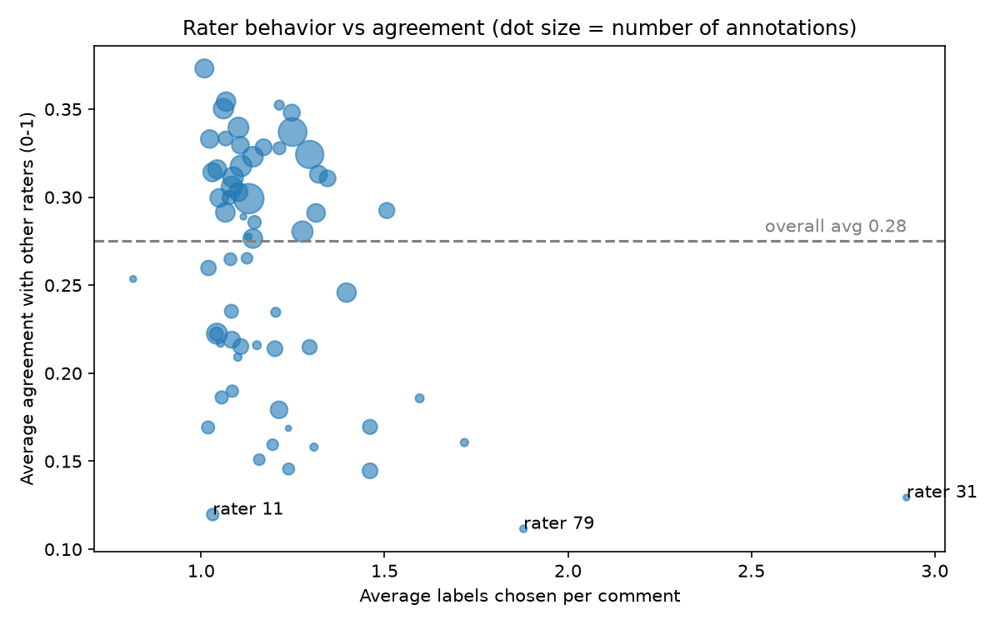
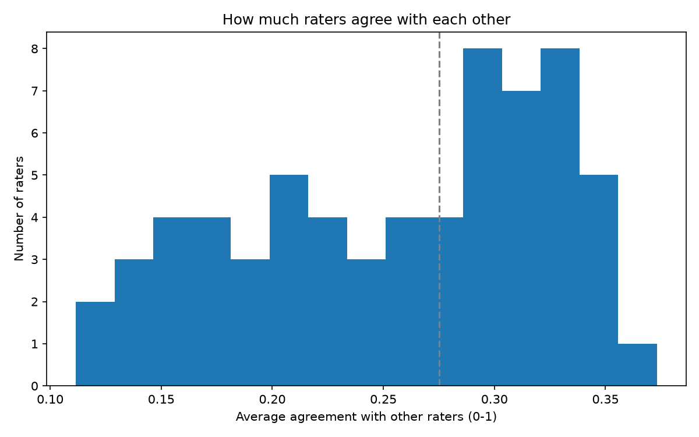

# Annotation Disagreement Analyzer

SQL + Python analysis of annotator disagreement and rater quality on the
GoEmotions dataset (Reddit comments labeled with 28 emotion categories).

## Question
Where do human annotators disagree, and which raters are driving low
agreement? This is the kind of check a data quality team runs before
trusting labels for model training or evaluation.

## Data
GoEmotions raw annotations (Google Research, Demszky et al., 2020):
one row per rater per comment. I sampled 3,000 comments (random seed 1)
and kept every rater's labels for each: 10,931 annotations from 80 raters.

## Method
1. `src/load_data.py` downloads the raw files and samples comments.
2. `src/load_to_sqlite.py` loads the sample into a SQLite database.
3. SQL queries (`sql/`) find the most disputed comments and compare
   raters' labeling habits.
4. `src/rater_agreement.py` scores each rater by the average overlap
   (Jaccard similarity) between their labels and the other raters' labels
   on the same comments.
5. `src/make_charts.py` produces the charts below.

## Findings
- Overall agreement is low: **0.28** on a 0-1 scale. On average, two raters
  share about a quarter of their labels on the same comment.
- **Over-labelers.** Rater 31 chose 2.92 labels per comment (26 annotations)
  and rater 79 chose 1.88 (33 annotations). Their agreement was 0.13 and
  0.11, among the lowest.
- **A second type of low-agreement rater.** Rater 11 chose about 1 label per
  comment (1.03, over 95 annotations) yet agreed with others only 0.12 of
  the time. My hypothesis is that this rater reads the emotion categories
  differently, not that they label too much. I have not tested this yet.
- Raters with many annotations tend to sit at higher agreement. This could
  reflect experience or just less noise in larger samples.





## Limitations
- The score penalizes raters who choose many labels: if one rater gives 1
  label and another gives 3, the best possible overlap is 0.33. Part of the
  low score for raters 31 and 79 comes from the measure itself.
- Raters with fewer than about 30 annotations give noisy scores.
- My first disagreement ranking (counting emotions that raters split on)
  was inflated by heavy labelers, which is why I added the per-rater view.
- The 25 reviewed comments are not a random sample of the 181 zero-agreement
  comments, so the reason counts describe those 25 only.

## How to run
```
pip install -r requirements.txt
python src/load_data.py
python src/load_to_sqlite.py
python src/run_sql.py sql/02_disagreement.sql
python src/rater_agreement.py
python src/make_charts.py
```

## Next steps
- Tag a random sample of the 181 zero-agreement comments to check whether the
  reasons hold up.
- Try an agreement measure that is not biased by label count.

## Why do raters disagree? (qualitative review)
Of 2,963 comments with 3 or more raters, **181 (6.1%) had zero label overlap**
between all raters. I took 25 of these (the first ones in the export, not a
random sample) and tagged the main reason for each. Tags were drafted with AI
assistance and reviewed by me.

| Reason | Count | Share |
|---|---|---|
| Needs context (refers to something not in the text) | 7 | 28% |
| Mixed emotions | 6 | 24% |
| Sarcasm / irony | 5 | 20% |
| Similar categories (e.g. anger vs. annoyance) | 3 | 12% |
| Vague / no clear emotion | 3 | 12% |
| Other (opinion statement) | 1 | 4% |

**Takeaway:** only 3 of 25 cases came from raters confusing neighboring labels.
Most zero-agreement comments came from missing context, several feelings in one
comment, or irony. These are problems with the text or the task, so fixing them
means changing the guidelines (for example, showing the parent comment), not
retraining raters.

Examples:
- *"Wow this basically means that 99% of bollywood movies are basically
  documentaries! This changes everything!"* Five raters chose five different
  labels (joy, neutral, realization, excitement, admiration). The irony is easy to miss.
- *"It's even creepier when it's happening TO you. Source: I carried two VERY
  active babies."* Labels ranged from sadness to fear to neutral. Without the
  parent comment, the topic and tone are unclear.
- *"This. Nurses already have one of the hardest jobs on the planet. They
  shouldn't have to waste time on this."* It mixes agreement with frustration, so
  raters chose approval, disapproval, neutral, or sadness.

**Limits of this review:** one reviewer, 25 comments, all taken from the
zero-agreement group (not a random sample), and the tags are subjective.